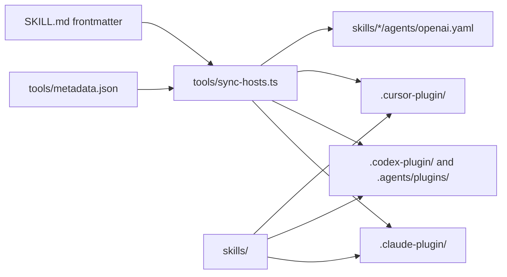

# CStack

This is a portable engineering toolkit for coding agents. It runs the same workflows in Claude Code, Codex, Cursor, and Intent: investigate, design, build, verify, and review. It builds on [PStack by Lauren Tan (poteto)](https://github.com/cursor/plugins/tree/main/pstack).

## Write a prompt

A prompt states what you want and how to tell when it is done. Put in:

- **The goal.** Say what is wrong, or what you want.
- **The done check.** Name something that can pass or fail. "Make it better" and "work on it for an hour" are not checks.
- **The proof to show.** Ask for the real command output, a video of the flow, the stored value, or a before and after number.
- **What you already know.** Add a symptom, a repro step, a log line, or a link.
- **The real constraints.** "Reproduce it first", "don't change any code yet", "no behavior change", and "let me review the design first" each change what the agent does.

Hold back your theory of the cause until the agent restates the problem, because a stated guess narrows its search. For a long thread or a vague report, make the restatement the first step:

```text
Read this thread and restate the underlying issue
in plain words. Don't change any code yet.
```

For a change you will leave running, the `align` skill asks you for the goal, the done check, and the proof, and records them in a signed spec. 

## Keep yourself the only author

Each harness adds its own attribution, which you turn off on your computer:

| Harness | Setting |
| --- | --- |
| Claude Code | In `~/.claude/settings.json`: `"attribution": { "commit": "", "pr": "", "sessionUrl": false }` |
| Codex | None needed. Current versions add no attribution. |
| Cursor | Turn off Commit Attribution and PR Attribution in Cursor Settings. For the CLI, in `~/.cursor/cli-config.json`: `"attribution": { "attributeCommitsToAgent": false, "attributePRsToAgent": false }` |

Cloud agents (Claude Code on the web, Codex cloud tasks, Cursor cloud agents) can add attribution that no setting removes, such as a bot commit identity or a comment footer.

## Choose a skill

| Task | Skill |
| --- | --- |
| Explain how existing code works | `how` |
| Investigate why a decision was made | `why` |
| Agree a signed spec with the agent before it works alone | `align` |
| Compare designs before implementation | `architect` |
| Stress-test a plan and record its glossary and decisions | `grill-with-docs` |
| Show a design or change as code, diffs, or diagrams | `show-me` |
| Build with a failing test first | `tdd` |
| Design or polish a UI and prove every state renders | `design-ui` |
| Drive a UI or CLI to verify a change | `control-ui`, `control-cli` |
| Check a benchmark result before you trust it | `benchmark-checklist` |
| Write clear prose for people | `simple-as-prose` |
| Write prompts, skills, and agent instructions | `writing-for-agents` |
| Capture lessons from a session or a PR you just finished | `reflect` |
| Stop agents repeating the same mistake | `correct` |

The [skill directory](skills/) has the full catalog. This README is the repository's only human guide.


## How the repository is laid out

One core serves every harness. Each harness that loads plugins gets a thin adapter that uses its own native plugin format.



| Path | Role |
| --- | --- |
| `skills/` | The core. Skills in the shared `SKILL.md` format, with no harness tool names. |
| `.claude-plugin/`, `.codex-plugin/`, `.agents/plugins/`, `.cursor-plugin/` | Generated manifests. Never edit them by hand. |
| `tools/metadata.json` | The single source for the plugin's name, version, and description. |
| `contrib/` | Optional sources that need one vendor's automation APIs. No manifest loads them. |


```bash
bun run --cwd tools sync:hosts
```

## Develop and verify

Tooling uses Bun and strict, erasable TypeScript. The versions are pinned in [package.json](tools/package.json) and the dependency lockfile.

With the pinned Bun runtime available, run these commands from a checkout:

```bash
bun install --cwd tools --frozen-lockfile --ignore-scripts
bun run --cwd tools typecheck
bun run --cwd tools check:hosts
bun run --cwd tools test
```

`check:hosts` fails when a generated manifest or `openai.yaml` no longer matches its source. GitHub Actions runs all of these on pull requests and pushes to main. The tests are grouped by what they exercise.

| Location | Category | Execution |
| --- | --- | --- |
| `tests/integration/` | Real CLI processes, filesystem stores, Git worktrees, and bundled resource links | `test:integration` |

For a Linux x86_64 cloud environment with Node and npm available, use `bash tools/setup.sh` as the install script. It installs the pinned Bun runtime into `/workspace/.plugin-tools`, installs locked dependencies, and runs the checks. Add `/workspace/.plugin-tools/bin` to the environment PATH. Set `SETUP_TOOL_ROOT` to install somewhere else.

## PStack updates

PStack updates arrive through reviewed, agent-assisted imports. An agent compares upstream changes with the recorded baseline, adapts useful changes to the harness-neutral core, and verifies the result in a PR. The plugin can change upstream structure and behavior to suit its own design.

The imported baseline is PStack 0.15.13 at `cursor/plugins@2cbf58508f40de470d7490b55c51d71241928fa2`. The original import of 0.15.5 remains in Git history at `c31f7ace991843f5576398ad025969465251192c`.

## License

[MIT](LICENSE). Upstream license notices and source provenance remain with the imported material. `align`, `grill-with-docs`, and `domain-modeling` adapt [mattpocock/skills](https://github.com/mattpocock/skills), `show-me` adapts [humanlayer/skills](https://github.com/humanlayer/skills), and `deslop`, `control-ui`, and `control-cli` adapt [Cursor Team Kit](https://github.com/cursor/plugins/tree/main/cursor-team-kit). Each keeps its upstream MIT license and an `origin.json` beside its `SKILL.md`.
